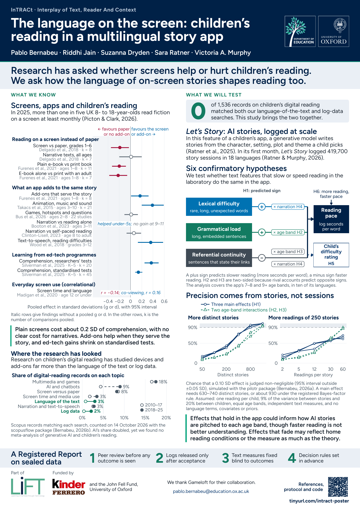

# The language on the screen: children's reading in a multilingual story app

A conference poster on InTRACt (Interplay of Text, Reader And Context), a study of how the
language of AI-written stories relates to children's reading in a story app. InTRACt is part of
the [LiFT project](https://www.education.ox.ac.uk/project/lift-learning-in-families-through-technology/)
(Learning in Families through Technology) at the Department of Education, University of Oxford.

Pablo Bernabeu, Riddhi Jain, Suzanna Dryden, Sara Ratner and Victoria A. Murphy, Department of
Education, University of Oxford. Contact:
[pablo.bernabeu@education.ox.ac.uk](mailto:pablo.bernabeu@education.ox.ac.uk).

<a href="poster.pdf"></a>

[Poster (PDF, A1)](poster.pdf) · [Print file with 3 mm bleed](poster-print.pdf) ·
[Study protocol](../preregistration/) · [References](#references)

## The study in brief

Research on children's reading on screens has mostly asked whether screens help or hurt. InTRACt
asks how the language of the stories on the screen shapes reading. It draws on the reading logs
of *Let's Story*, a feature of a children's app in which a child picks a hero, a companion, a
setting, a plot and a theme. A generative model then writes the story (Ratner et al., 2025). In
its first month, the feature logged 419,700 story sessions in 18 languages (Ratner & Murphy,
2026).

The study tests whether text features that slow or speed reading in the laboratory do the same
in everyday app use. The outcome is the time a child spends per word over a whole story,
analysed on a log scale. The study is a Registered Report, in which the protocol is peer-reviewed
before any outcome is seen. The logs are released only after in-principle acceptance, the text
measures are fixed blind to the outcomes, and every decision rule is set in advance. Stage 1 is
in preparation.

### Hypotheses

The six confirmatory hypotheses, in their registered order:

| | Prediction |
|---|---|
| H1 | Lexical difficulty (rare, long and unexpected words) and grammatical load (long, embedded sentences) slow reading, and referential continuity (sentences that state their links) speeds it. |
| H2 | The effect of grammatical load differs between the two age bands, 7 to 8 and 9 and over. Rival accounts predict opposite directions, so the test is two-sided. |
| H3 | The effect of referential continuity differs between the age bands, again tested two-sided. |
| H4 | Narration shrinks the effect of lexical difficulty proportionally more than that of referential continuity, by more than 0.20. |
| H5 | The features that slow reading make a child likelier to give the story a harder rating, and they rank by size as they do for reading time. |
| H6 | Within a child, more reading in the app goes with faster reading. |

The poster states these predictions as slower or faster reading. The protocol states them on log
reading time per word, of which log reading speed is the exact negative, so a feature that slows
reading has a positive coefficient there.

### Precision

Precision comes from the number of distinct stories, not the number of sessions, because more
readings of the same stories add less than new stories do. In the protocol's design analysis,
simulated with the pilotr package (Bernabeu, 2026a), a main effect of 0.10 SD needs 630 to 740
distinct stories for a 90% chance of a clear verdict. A verdict is clear when its 95% interval
lies wholly outside ±0.05 SD. Under the registered Bayes-factor rule, which also asks for an
interval Bayes factor of at least 10, it needs about 930. The simulation assumes one reading per child, 9% of the variance between
stories and 20% between children, equal age bands and independent text measures, and it
includes no language terms, covariates or priors.

## What the evidence shows

Reading a plain e-book in place of a print book costs children about 0.2 SD of comprehension,
with no clear cost for narrative texts (Delgado et al., 2018; Furenes et al., 2021). Add-ons help
when they serve the story (Furenes et al., 2021; Takacs et al., 2015), and narration helped
children under 5 but showed no clear gain at 9 to 11 (Booton et al., 2023). Gains from
educational technology are larger on researchers' own tests than on standardised ones
(Silverman et al., 2025). Everyday screen time correlates weakly and negatively with language
skills, and viewing with an adult positively (Madigan et al., 2020).

The poster's evidence map draws on meta-analyses and systematic reviews of digital technology and
children's reading, found in a search run in October 2026. Where syntheses overlap, it keeps the
most recent one or the one with a child-specific estimate. It leaves out subgroup values that
rest on two or three studies or could not be checked against the published paper. The table
below gives every row. Effects are Hedges' g or Cohen's d, and a positive value favours the
screen or the add-on. In the last column, k is the number of comparisons pooled. Rows in italics report findings that
cannot share that scale, a review's conclusion or a correlation. The search found no
meta-analysis of generative AI and children's reading, language or literacy. The closest ones
pool mostly university students, so the poster states the gap and plots nothing for AI.

<!-- evidence:start -->

| Finding | Source | Children | Effect [95% CI] | Pooled |
|---|---|---|---|---|
| **Reading on a screen instead of paper** | | | | |
| Screen vs paper, grades 1–6 | [Delgado et al. (2018)](https://doi.org/10.1016/j.edurev.2018.09.003) | – | −0.19 [−0.35, −0.03] | k = 8 |
| Narrative texts, all ages | [Delgado et al. (2018)](https://doi.org/10.1016/j.edurev.2018.09.003) | – | 0.01 [−0.20, 0.20] | k = 7 |
| Plain e-book vs print book | [Furenes et al. (2021)](https://doi.org/10.3102/0034654321998074) | ages 1–8 | −0.20 [−0.33, −0.08] | k = 11 |
| E-book alone vs print with an adult | [Furenes et al. (2021)](https://doi.org/10.3102/0034654321998074) | ages 1–8 | −0.22 [−0.38, −0.06] | k = 7 |
| **What an app adds to the same story** | | | | |
| Add-ons that serve the story | [Furenes et al. (2021)](https://doi.org/10.3102/0034654321998074) | ages 1–8 | 0.17 [0.01, 0.32] | k = 8 |
| Animation, music and sound | [Takacs et al. (2015)](https://doi.org/10.3102/0034654314566989) | ages 3–10 | 0.39 [0.20, 0.59] | k = 21 |
| Games, hotspots and questions | [Bus et al. (2026)](https://doi.org/10.1080/10409289.2025.2571978) | ages 2–8 | 0.01 [−0.11, 0.13] | 22 studies |
| Narration vs reading alone | [Booton et al. (2023)](https://doi.org/10.1080/09588221.2021.1930057) | ages 3–11 | *no clear gain at 9–11; helped under-5s* | – |
| Narration vs self-paced reading | [Clinton-Lisell (2023)](https://eric.ed.gov/?id=EJ1403866) | age 8 to adult | 0.06 [−0.07, 0.19] | – |
| Text-to-speech, reading difficulties | [Wood et al. (2018)](https://doi.org/10.1177/0022219416688170) | grades 3–12 | 0.36 [0.13, 0.58] | – |
| **Learning from ed-tech programmes** | | | | |
| Comprehension, researchers’ tests | [Silverman et al. (2025)](https://doi.org/10.3102/00346543241261073) | K–5 | 0.37 [0.25, 0.50] | k = 20 |
| Comprehension, standardised tests | [Silverman et al. (2025)](https://doi.org/10.3102/00346543241261073) | K–5 | 0.14 [0.08, 0.21] | k = 45 |
| **Everyday screen use (correlational)** | | | | |
| Screen time and language | [Madigan et al. (2020)](https://doi.org/10.1001/jamapediatrics.2020.0327) | age 12 or under | *r = −0.14; co-viewing, r = 0.16* | – |

<!-- evidence:end -->

`data/evidence.csv` records the table or page of the source each value was read from, and where
a paper's text and tables disagree.

## Where the research has looked

The poster's second figure gives each topic's share of the Scopus records on children's digital
reading from 2010 to 2025, counted with the scopusflow package (Bernabeu, 2026b). None of the
1,536 records matched both the search on the language of the text and the search on log data.
The counts include false positives and are not counts of screened studies.
`data/scopus_search_record.md` gives every query verbatim, with the limits and the totals, which
are the PRISMA-S items a count-only search can supply, and `data/scopus_focus_trends.csv` gives
the counts by year.

## Data and materials

Everything on the poster is computed from the files in this folder, and nothing on it comes from
the app's logs or its story texts.

- `data/evidence.csv`: the evidence map, one row per finding, with its source and location.
- `data/scopus_*`: the Scopus counts and the full search record, from 14 October 2026.
- `data/design_analysis/`: the protocol's design-analysis outputs behind the precision figure,
  copied on 15 October 2026 from `../preregistration/design_analysis/`.
- `references.bib`: the works the poster cites, with fields checked against Crossref and CRAN.

## References

<!-- references:start -->

Bernabeu, P. (2026a). *pilotr: Simulate experimental and behavioural data from a portable design specification* (Version 0.3.0) \[Computer software\]. Comprehensive R Archive Network. <https://doi.org/10.32614/CRAN.package.pilotr>

Bernabeu, P. (2026b). *scopusflow: A reproducible workflow layer for Scopus bibliographic searches* (Version 0.4.0) \[Computer software\]. Comprehensive R Archive Network. <https://doi.org/10.32614/CRAN.package.scopusflow>

Booton, S. A., Hodgkiss, A., & Murphy, V. A. (2023). The impact of mobile application features on children’s language and literacy learning: A systematic review. *Computer Assisted Language Learning*, *36*(3), 400–429. <https://doi.org/10.1080/09588221.2021.1930057>

Bus, A., Kucirkova, N., Ten Braak, D., & Ciesielska, M. (2026). Which interactive features in children’s digital picture books promote reading comprehension? A meta-analysis. *Early Education and Development*, *37*(2), 269–288. <https://doi.org/10.1080/10409289.2025.2571978>

Clinton-Lisell, V. (2023). Does reading while listening to text improve comprehension compared to reading only? A systematic review and meta-analysis. *Educational Research: Theory and Practice*, *34*(3), 133–155. <https://eric.ed.gov/?id=EJ1403866>

Delgado, P., Vargas, C., Ackerman, R., & Salmerón, L. (2018). Don’t throw away your printed books: A meta-analysis on the effects of reading media on reading comprehension. *Educational Research Review*, *25*, 23–38. <https://doi.org/10.1016/j.edurev.2018.09.003>

Furenes, M. I., Kucirkova, N., & Bus, A. G. (2021). A comparison of children’s reading on paper versus screen: A meta-analysis. *Review of Educational Research*, *91*(4), 483–517. <https://doi.org/10.3102/0034654321998074>

Madigan, S., McArthur, B. A., Anhorn, C., Eirich, R., & Christakis, D. A. (2020). Associations between screen use and child language skills: A systematic review and meta-analysis. *JAMA Pediatrics*, *174*(7), 665–675. <https://doi.org/10.1001/jamapediatrics.2020.0327>

Ratner, S., & Murphy, V. A. (2026). Productive struggle in children’s app-based digital reading. *Frontiers in Developmental Psychology*, *4*, 1816559. <https://doi.org/10.3389/fdpys.2026.1816559>

Ratner, S., Ong, C., Mathers, S., & Murphy, V. A. (2025). ‘Did a robot write that?’: AI-generated digital storybooks. *ELT Journal*, *79*(4), 595–604. <https://doi.org/10.1093/elt/ccaf034>

Silverman, R. D., Keane, K., Darling-Hammond, E., & Khanna, S. (2025). The effects of educational technology interventions on literacy in elementary school: A meta-analysis. *Review of Educational Research*, *95*(5), 972–1012. <https://doi.org/10.3102/00346543241261073>

Takacs, Z. K., Swart, E. K., & Bus, A. G. (2015). Benefits and pitfalls of multimedia and interactive features in technology-enhanced storybooks: A meta-analysis. *Review of Educational Research*, *85*(4), 698–739. <https://doi.org/10.3102/0034654314566989>

Wood, S. G., Moxley, J. H., Tighe, E. L., & Wagner, R. K. (2018). Does use of text-to-speech and related read-aloud tools improve reading comprehension for students with reading disabilities? A meta-analysis. *Journal of Learning Disabilities*, *51*(1), 73–84. <https://doi.org/10.1177/0022219416688170>

<!-- references:end -->

## Rebuilding the poster

<details>
<summary>Software, build steps and design notes</summary>

The poster is written in Quarto with an R chunk that draws every figure, and Typst lays out the
sheet. From this folder, render the print file first, because Quarto writes `poster.pdf` and
then renames it:

```bash
quarto render poster.qmd -M bleed:true --output poster-print.pdf
quarto render poster.qmd
Rscript R/preview.R                                 # poster-preview.png, 72 dpi
Rscript --no-save --no-restore R/scopus_counts.R   # only to refresh the Scopus counts
```

Rendering needs R (4.6.1 here) with ggplot2, patchwork, svglite, systemfonts, ragg, qrcode,
scales, jsonlite, rmarkdown and depictr, and Quarto (1.10.19 here, which bundles Typst 0.15.1
and Pandoc 3.10). Set `QUARTO_R` to R's `bin` folder if Quarto cannot find R. The render makes no
network request, and everything it reads is in this folder except the protocol's citation style,
`../preregistration/apa7.csl`. `R/preview.R` needs pdftools and png, and it stops on a PDF that is
not a single A1 page. `R/scopus_counts.R` needs scopusflow 0.4.0 and a Scopus API key in the
`SCOPUS_API_KEY` environment variable.

`R/figures.R` draws each figure at the width it is printed, 269 mm, so a point size in R is a
point size on paper. `depictr::check_figure()` audits each figure at that width before it is
written.
The audit covers the smallest text (23 pt), contrast, and separability of colours in greyscale
and under simulated colour-vision deficiency. `R/references.R` writes the reference list and the
evidence table on this page on every render. In the PDF, every citation links to its DOI.
`cite-links.lua` adds the links in the text, and the template lays invisible link boxes over the
evidence map's rows, whose positions `R/figures.R` writes with the figure.

The colours are Oxford blue (#002147) and the green of the department's tree (#1dad89), with a
darker shade of that green (#127b61) wherever it carries text or data. The typeface is Figtree,
kept in `fonts/` under the SIL Open Font License, which stands in for Abadi, licensed for
Microsoft 365 apps only. `poster.pdf` is exactly A1. `poster-print.pdf`, rendered with
`-M bleed:true`, adds 3 mm of bleed and crop marks on a 614 x 861 mm page.

</details>
